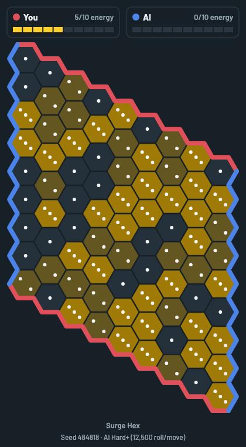
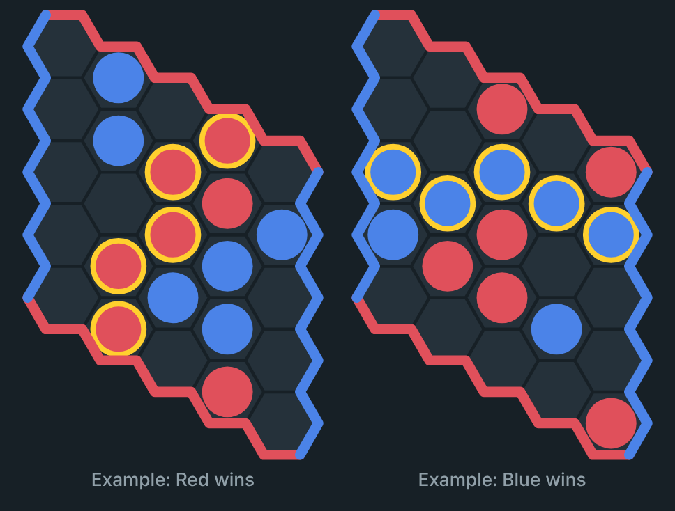
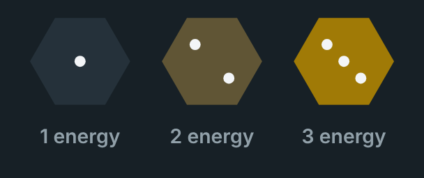
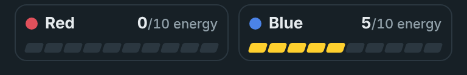
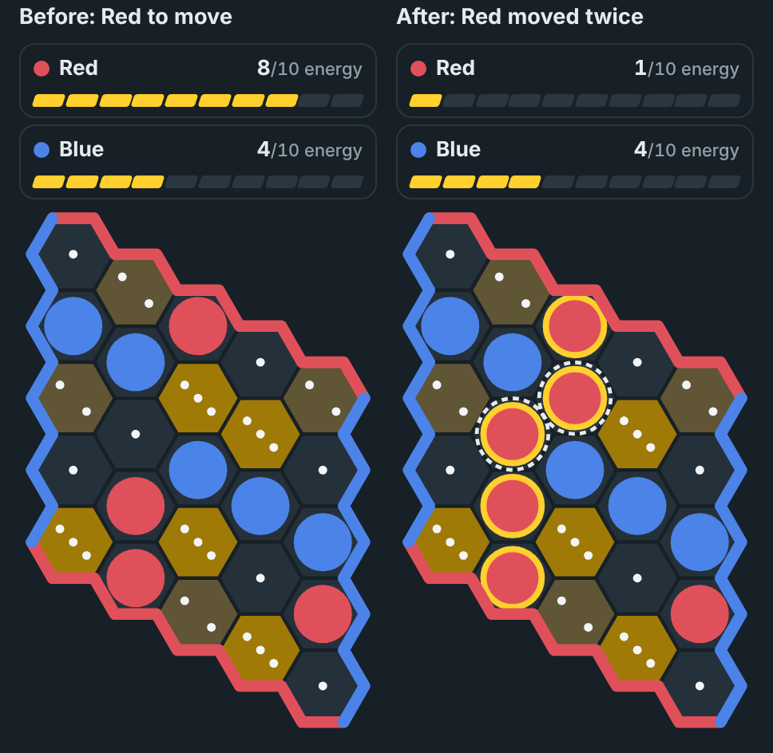
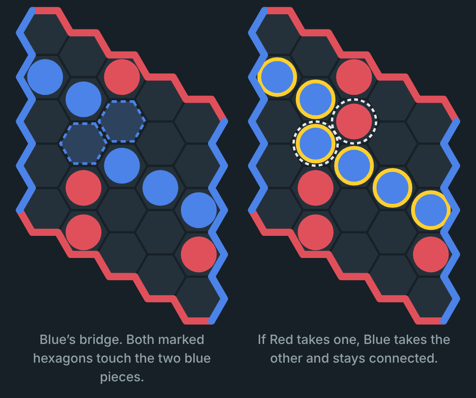
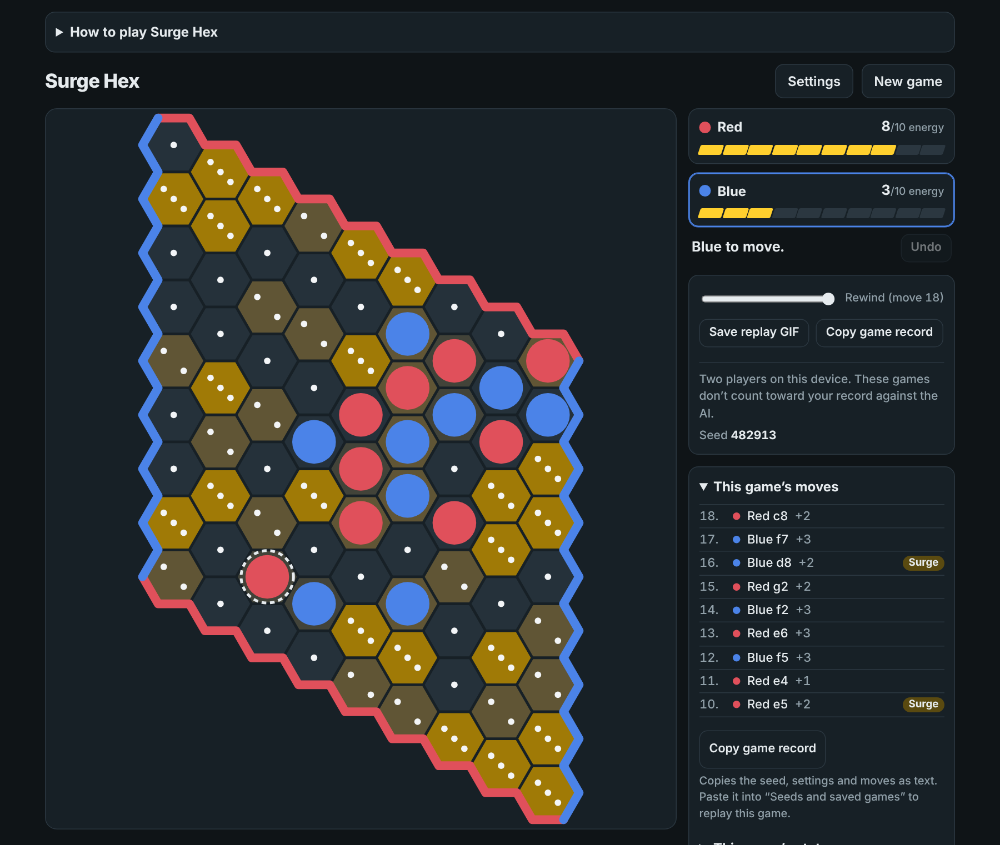

# Surge Hex

Surge Hex is an abstract two-player connection game based on the classic game [Hex](https://en.wikipedia.org/wiki/Hex_(board_game)). The twist is that every hexagon holds some energy, and collecting enough energy lets you play two pieces in a row.

**Play it here: https://mcnica89.github.io/surge-hex/**

<p align="center">
  
</p>

## TL;DR How to play Surge Hex

- Take turns placing pieces (*click a hexagon*). Connect the two edges that match your colour to win (red connects top to bottom, blue connects left to right).
- Each hexagon holds 1, 2 or 3 energy (the dots). Placing a piece *collects that energy*. Energy is shown in the bars on top (1st player starts at 0, 2nd player starts at 5).
- At 10 or more energy, you **surge**. Your energy resets to 0 and *you immediately play an extra piece*.

See [How to play](#how-to-play) below for details and examples.

## How to play

### Object of the Game

Two players *take turns placing one piece* of their colour on an empty hexagon. In the web version, you click a hexagon to place your piece. Pieces cannot move once placed.

Red wins by making an unbroken chain of red pieces that *joins the two red edges*, at the top and bottom of the board. Blue wins by making a chain that *joins the two blue edges*, on the left and right.

<p align="center">
  
</p>

So far, this is just like the classic game Hex. The twist in Surge Hex is *energy and surge moves*.

### Energy

Every hexagon holds 1, 2 or 3 energy, which is randomized at the start of each game. The dots show how much energy is on each hexagon.

<p align="center">
  
</p>

When you place a piece, *you collect the energy on that hexagon*. Your energy is shown in the bars at the top.

<p align="center">
  
</p>

To offset the advantage of moving first, the 2nd player *starts the game with 5 energy*.

### Surge (Extra Move for ≥10 Energy)

When your energy reaches 10 or more, you **surge**. You *immediately get to play an extra piece*, and your energy resets to 0.

**Example:** Red has 8 energy and plays on a 3-energy hexagon, reaching 11. Red surges, using up all 11 energy, and plays one extra piece on a 1-energy hexagon.

<p align="center">
  
</p>

Surging is *not optional*. The extra piece collects energy as normal.

### Surge Strategy Tips

In classic Hex, two pieces of the same colour form a [bridge](https://www.mseymour.ca/hex_book/hexstrat1.html#section_5) when there are two empty hexagons between them that both touch both pieces. A bridge is normally safe, because if the opponent takes one of the two empty hexagons, the bridge's owner just takes the other.

<p align="center">
  
</p>

A surge changes that. A player who surges can take both hexagons before the other player can answer, which cuts the bridge. In other words, surges *break the if-you-go-here-I-go-there logic* of classic Hex, so it's important to keep an eye on energy levels and plan for surges.

## Features



- **Play against the AI** at any strength, from Easy to Very hard. You can also set an exact number of rollouts per move, or let the difficulty adapt as you win and lose.
- **Play with a friend** on the same device.
- **Undo, rewind and replay.** Drag the slider to look back through a game, or pick an earlier move and choose "Play from here".
- **Save a replay GIF** of any game.
- **Seeds and game records.** Every game has a seed that sets its energy layout. You can copy a game record and paste it in later to replay or continue the game.
- **Board options:** board sizes from 5×5 to 13×13, four board orientations, optional coordinates, and dark or light colours.
- **Custom rules** for energy values, the surge value, the 2nd player's starting energy and how surges use energy.

## How the AI works

The AI chooses its moves with a method called *Monte Carlo tree search* (MCTS). To decide on a move, the AI plays many quick practice games against itself, starting from the current position. In these practice games, the moves are mostly chosen at random. Each practice game is called a *rollout*. Rollouts follow the full rules of Surge Hex, including energy and surges.

After each rollout, the AI notes which player won. Moves that lead to more wins get tried more often, and moves that keep losing get tried less often. When the AI has finished all its rollouts, it plays the move it found most promising in the simulations.

The AI also uses two tricks to learn faster. The first trick is called RAVE (Rapid Action Value Estimation). With RAVE, the AI learns from every move played in a rollout, not just the first one. The second trick makes the rollouts look more like real Hex. When a rollout attacks one of a player's bridges, that player always defends it.

The more rollouts the AI plays before each move, the stronger and slower it gets. Easy uses 500 rollouts per move, Medium uses 3,000, Hard uses 12,000 and Very hard uses 40,000.

To see how MCTS works in more detail, watch Mihai Nica's [explainer video on MCTS](https://youtu.be/uQUsAndESdQ).

## Seeds and game records

A seed is a whole number, such as 482913. The seed only decides how much energy each hexagon holds. Who moves first and the AI's moves are not taken from it, which is why a game record lists its moves.

The seed is used directly as the starting state of a Mulberry32 random number generator. Hexagons are filled row by row, starting at a1, b1, c1 and so on, then a2, b2, and so on. Letters count columns from the blue edge on the left, and numbers count rows from the red edge at the top. Each hexagon takes the next random number `r` and gets the energy value at position `floor(r × count)` in the list of energy values, in the order written.

```js
function mulberry32(a) {
  return function () {
    a |= 0; a = (a + 0x6D2B79F5) | 0;
    let t = Math.imul(a ^ (a >>> 15), 1 | a);
    t = (t + Math.imul(t ^ (t >>> 7), 61 | t)) ^ t;
    return ((t ^ (t >>> 14)) >>> 0) / 4294967296;
  };
}

const rand = mulberry32(482913);    // the seed
const values = [1, 2, 3];          // energy values, in order
for (let row = 0; row < N; row++)
  for (let col = 0; col < N; col++)
    energy[row][col] = values[Math.floor(rand() * values.length)];
```

To check your version: with the standard rules on a 9×9 board, the seed 482913 gives a top row (a1 to i1) of `1 3 3 2 3 3 1 1 3` energy.

A game record looks like this. You can paste it into the game under "Seeds and saved games".

```
Surge Hex game record
Seed: 482913
Board: 9x9
First: Red
Rules: standard
Moves: e5 d7 f3 c4
```

## Running it yourself

The whole game is a single file, `index.html`, with nothing to install. Open it in a web browser to play. 

## AI disclosure

Game design by Mihai Nica based on the classic game Hex. Coding by Claude Opus 5.5.
